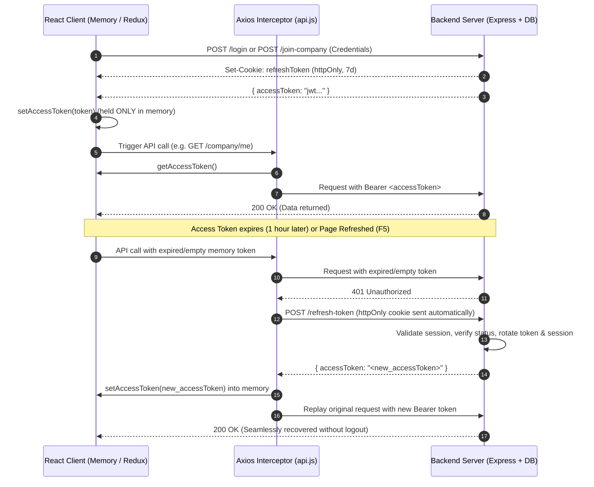

# HireHub - Authentication, Token & Security Architecture Documentation

This document provides a comprehensive guide to the **Authentication, Session Management, In-Memory Token Architecture**, and **Recruiter/Company API & Route Hierarchy** implemented in HireHub.

---

## 1. Security Architecture: In-Memory Access Tokens

HireHub implements modern **OAuth 2.0 / JWT Security Best Practices**:

| Token Type | Storage Location | Lifetime | Transmission | Purpose |
|---|---|---|---|---|
| **Access Token** | **Browser Memory** (JavaScript runtime memory / Redux) | 1 hour | `Authorization: Bearer <token>` Header | Authenticates API requests; never written to disk (`localStorage`/`sessionStorage`) to eliminate XSS token theft. |
| **Refresh Token** | **`httpOnly` Cookie** | 7 days | Automated browser cookie jar (`credentials: include`) | Silently requests a new access token; inaccessible to JavaScript, protecting against malicious scripts. |

### In-Memory Token Lifecycle Diagram



---

## 2. Frontend Implementation Files

### A. [`utils/tokenStorage.js`](file:///c:/Users/4s%20Bazzar/Desktop/Web%20Development/Faisal%20Abbas/HireHub/frontend/src/utils/tokenStorage.js)
Manages the in-memory access token & role closures:
- `setAccessToken(token)`: Stores the token inside private variable `memoryAccessToken` and automatically extracts the user's role from the JWT payload into `memoryRole`.
- `getAccessToken()`: Returns current token strictly from runtime memory.
- `getRole()` / `setRole(role)`: Manages role strictly in JavaScript memory closure.
- `clearAccessToken()`: Resets `memoryAccessToken = null` and `memoryRole = null`.
- `setAuthSession(token, user, role)`: Keeps access token, role, and user strictly in-memory (no disk writes), while purging any legacy keys from `localStorage` and `sessionStorage`.
- `getAuthSession()`: Returns `{ token: getAccessToken(), role: getRole(), user: null }` from memory.
- `clearAuthSession()`: Wipes in-memory tokens/roles and purges any legacy browser storage keys upon logout.

### B. [`services/api.js`](file:///c:/Users/4s%20Bazzar/Desktop/Web%20Development/Faisal%20Abbas/HireHub/frontend/src/services/api.js)
Axios instance configured with `withCredentials: true`:
- **Request Interceptor**: Directly reads from `getAccessToken()` in memory.
- **Response Interceptor (401)**:
  - Detects expired/invalid tokens.
  - Inspects `role` (`"recruiter"`, `"company"`, or `"candidate"`) from storage to route to the correct refresh endpoint (`/recruiter/refresh-token`, `/company/refresh-token`, etc.).
  - Saves the rotated access token directly into browser memory (`setAccessToken`).
  - Automatically replays the original request.
  - On complete refresh failure (revoked session), clears memory and storage to initiate a clean redirect to login.

### C. [`features/auth/authSlice.js`](file:///c:/Users/4s%20Bazzar/Desktop/Web%20Development/Faisal%20Abbas/HireHub/frontend/src/features/auth/authSlice.js)
- **Zero Redux Persist**: Auth state lives purely in Redux memory (`state.auth.user`, `state.auth.token`).
- **No User Storage on Disk**: Neither signup, login, OTP verification, recruiter joining, nor `getMe` writes user documents to `localStorage`.
- **`silentRefreshToken` Async Thunk**: Dispatched on page reload (F5) when the in-memory token is empty but a valid session cookie exists. Immediately follows up by fetching profile via `getMe()` to rehydrate Redux user state.
- **`recruiterJoinCompany` Async Thunk**: Registers/joins the recruiter via invite code and saves the issued access token into memory.
- **`updateToken` Action**: Allows interceptors to keep Redux in-memory state in sync with runtime memory.
- **`clearAllAuth` Helper**: Centralized cleanup for logout.

### D. [`routes/ProtectedRoute.jsx`](file:///c:/Users/4s%20Bazzar/Desktop/Web%20Development/Faisal%20Abbas/HireHub/frontend/src/routes/ProtectedRoute.jsx)
- Handles seamless rehydration:
  - If a user opens the app or refreshes the page, the in-memory access token is initially null.
  - If a stored session exists (`currentRole`), `ProtectedRoute` runs `silentRefreshToken()` before rendering routes.
  - Displays a clean `<Loading session...>` screen during the brief rehydration window instead of flashing unauthenticated screens.

---

## 3. Backend Implementation & Bug Fixes

### A. Company Auth Controller ([`backend/Company/src/controllers/auth.js`](file:///c:/Users/4s%20Bazzar/Desktop/Web%20Development/Faisal%20Abbas/HireHub/backend/Company/src/controllers/auth.js))

| Bug Identified | Technical Cause | Implemented Fix |
|---|---|---|
| **Undefined Mongoose Import** | `mongoose.isValidObjectId` called without importing `mongoose`. | Added `const mongoose = require("mongoose");`. |
| **Cookie Name Mismatch** | `login()` set `res.cookie("refreshToken", ...)` but `refreshToken()` read `req.cookies.refreshtoken` (lowercase `t`). | Unified cookie access to `req.cookies?.refreshToken`. |
| **Uncaptured Verification** | `jwt.verify(refreshToken, secret)` was called without capturing its return value into `decoded`. | Changed to `decoded = jwt.verify(...)`. |
| **Incorrect Model Reference** | Used `sessionModel` (lowercase, undefined variable). | Corrected to imported `SessionModel`. |
| **Session Mutation vs Creation** | Old session was revoked, mutated, and saved again, causing dirty state. | Revokes old session (`revoked: true, status: "revoked"`), then creates a brand-new session document via `SessionModel.create(...)`. |
| **Logout Scoping Error** | `const session` was declared inside `if (token)` block but referenced outside it. | Fixed variable scope; added early return if token is missing. |
| **Dual Access Token Creation** | `login()` generated one access token for the session document and a second token for the JSON response. | Generates a single token pair reused in both the session document and response. |

### B. Recruiter Auth Controller ([`backend/Company/src/controllers/recruiter.js`](file:///c:/Users/4s%20Bazzar/Desktop/Web%20Development/Faisal%20Abbas/HireHub/backend/Company/src/controllers/recruiter.js))

- **`createRecruiterSession(recruiter, req)`**: Centralized session creation helper issuing short-lived `accessToken` (1h), `refreshToken` (7d), hashing the refresh token, and storing active session in MongoDB.
- **`setRefreshCookie(res, refreshToken)`**: Helper configuring httpOnly cookies with environment-aware `sameSite: process.env.NODE_ENV === "production" ? "none" : "lax"`.
- **`recruiterrefreshToken(req, res)`**: Fully implemented refresh controller:
  1. Validates `req.cookies?.refreshToken`.
  2. Verifies recruiter exists and `status === "active"`.
  3. Revokes existing session and creates a fresh session with rotated tokens.
- **Session Revocation on Deactivation**:
  - `updateRecruiterStatus`: When a recruiter is set to `inactive`, all active sessions are immediately revoked:
    ```javascript
    await SessionModel.updateMany({ recruiterId, revoked: false }, { revoked: true, status: "revoked" });
    ```
  - `removeRecruiter`: Deactivating a recruiter immediately revokes all their active sessions.

### C. Authentication Middlewares

- **`middleware/auth.js` (`companyAuth`)**: Removed insecure fallback to `req.cookies?.refreshToken`. Only accepts valid short-lived bearer tokens or `accessToken` cookies. Validates account in `Company` collection.
- **`middleware/recruiter.js` (`recruiterAuth`)**: Removed insecure fallback to `refreshToken` cookie. Only accepts short-lived tokens and validates account in `Recruiter` collection with `status !== "inactive"`.

---

## 4. Recruiter Profile & Route Collision Resolution

### The Problem:
`router/recruiter.js` previously contained duplicate route declarations for `GET /profile`:
```javascript
// ❌ Duplicate route collision:
router.get("/profile", companyAuth, getProfile);
router.get("/profile", recruiterAuth, getProfile);
```
1. **Route Shadowing:** Express routes match top-to-bottom. Any request to `/recruiter/profile` hit `companyAuth`.
2. When a recruiter called `/recruiter/profile`, `companyAuth` checked `Company.findById(recruiterId)` which returned `null` -> `404 User account not found`. The recruiter could never access their own profile.
3. When a company called `/recruiter/profile`, `getProfile` looked for `req.recruiter._id` which was `undefined` -> `400 Recruiter identity not found`.

### The Solution:
Routes were separated cleanly by role and path:
```javascript
// ✅ 1. Company Admin viewing a specific recruiter member (Requires companyAuth)
router.get("/company/recruiters/:recruiterId", companyAuth, getCompanyRecruiterProfile);

// ✅ 2. Recruiter viewing/updating their own personal profile (Requires recruiterAuth)
router.get("/profile", recruiterAuth, getProfile);
router.patch("/profile/update", recruiterAuth, updateProfile);
router.patch("/profile/picture", recruiterAuth, updateProfilePicture);
```

### Frontend Dynamic Profile Page ([`RecruiterProfilePage.jsx`](file:///c:/Users/4s%20Bazzar/Desktop/Web%20Development/Faisal%20Abbas/HireHub/frontend/src/features/company/pages/RecruiterProfilePage.jsx)):
- **Company Admin Mode (`/company/recruiter-profile?recruiter=<recruiterId>`)**:
  - Automatically fetches the target recruiter via `GET /recruiter/company/recruiters/:recruiterId`.
  - Disables personal profile edits (View Only).
  - Displays back button to the Team Management list.
- **Recruiter Personal Mode (`/company/recruiter-profile`)**:
  - Fetches the authenticated recruiter's personal profile via `GET /recruiter/profile`.
  - Enables editing and saving of personal details.

---

## 5. Complete API Endpoint Matrix

| Method | Endpoint Path | Auth Middleware | Description |
|---|---|---|---|
| `POST` | `/api/company/signup` | Public | Register new company account |
| `POST` | `/api/company/login` | Public | Company login; issues memory token + refresh cookie |
| `POST` | `/api/company/logout` | Cookie / Bearer | Logs out company session; revokes session document |
| `POST` | `/api/company/refresh-token` | Refresh Cookie | Rotates refresh token & issues new in-memory access token |
| `GET` | `/api/company/me` | `companyAuth` | Returns authenticated company profile |
| `POST` | `/api/recruiter/join-company` | Public | Recruiter joins via invite code; issues memory token + cookie |
| `POST` | `/api/recruiter/refresh-token` | Refresh Cookie | Rotates recruiter session & issues new in-memory access token |
| `POST` | `/api/recruiter/company/invite/verify-membership` | `recruiterAuth` | Verifies company QR & issues fresh in-memory tokens |
| `GET` | `/api/recruiter/profile` | `recruiterAuth` | Logged-in recruiter views their own profile |
| `PATCH`| `/api/recruiter/profile/update` | `recruiterAuth` | Logged-in recruiter updates their profile details |
| `GET` | `/api/recruiter/company/recruiters/:recruiterId` | `companyAuth` | Company Admin views a specific team member's profile |
| `PATCH`| `/api/recruiter/company/recruiters/:recruiterId/status` | `companyAuth` | Company Admin toggles status (`active`/`inactive`); revokes sessions on deactivation |
| `DELETE`| `/api/recruiter/company/recruiters/:recruiterId` | `companyAuth` | Company Admin deactivates recruiter and revokes all sessions |
