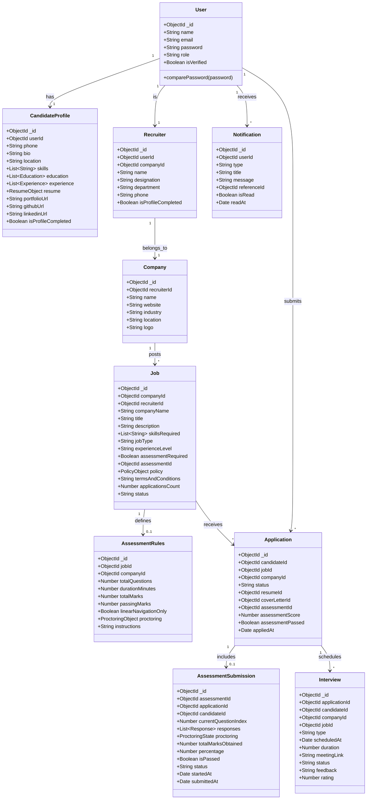
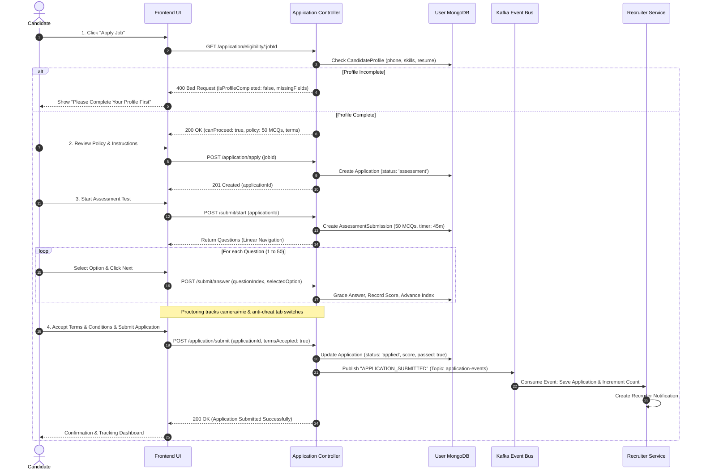
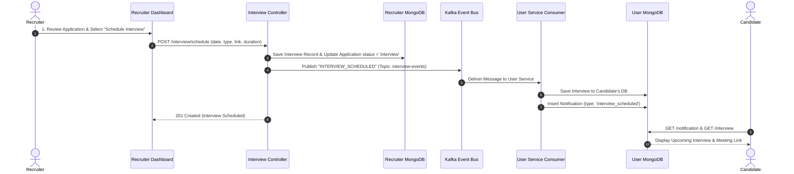

# HireHub - Complete UML Architecture & Design Diagrams

This document contains the complete UML diagrams illustrating the architecture, domain entities, and event-driven workflows of **HireHub**.

---

## 1. System Architecture & Event-Driven Topology

```mermaid
flowchart TB
    subgraph ClientLayer ["Client Applications"]
        CP["Candidate Portal (Web/Mobile)"]
        RP["Recruiter Portal (Company Dashboard)"]
    end

    subgraph GatewayLayer ["API Gateway"]
        GW["API Gateway (Port 3000)"]
    end

    subgraph ServicesLayer ["Microservices"]
        subgraph CandidateService ["Candidate / User Service (Port 3003)"]
            UA["Auth & Profiles"]
            UApp["Application Controller"]
            UAss["Assessment & Grading"]
            UInt["Interviews"]
            UNot["Notifications"]
            UConsumer["Kafka Consumer"]
            UProducer["Kafka Producer"]
        end

        subgraph RecruiterService ["Recruiter Service (Port 3002)"]
            RA["Auth & Recruiter Profile"]
            RJob["Job Management"]
            RApp["Applicant Review"]
            RRules["Assessment Rules"]
            RInt["Interview Scheduling"]
            RConsumer["Kafka Consumer"]
            RProducer["Kafka Producer"]
        end
    end

    subgraph MessageBroker ["Kafka Event Bus (Port 9092)"]
        T1["Topic: job-events\n(JOB_CREATED, JOB_UPDATED)"]
        T2["Topic: application-events\n(APPLICATION_SUBMITTED)"]
        T3["Topic: application-status-events\n(APPLICATION_STATUS_UPDATED)"]
        T4["Topic: interview-events\n(INTERVIEW_SCHEDULED)"]
    end

    subgraph DataLayer ["Data Stores"]
        M1[("MongoDB - User DB")]
        M2[("MongoDB - Recruiter DB")]
        RD[("Redis Cache")]
    end

    CP -->|REST / JWT| GW
    RP -->|REST / JWT| GW
    GW -->|Proxy /auth, /profile, /jobs, /application| CandidateService
    GW -->|Proxy /recruiter, /job, /interview| RecruiterService

    CandidateService --> M1
    CandidateService --> RD
    RecruiterService --> M2
    RecruiterService --> RD

    %% Event Flows
    RProducer -->|Publish| T1
    T1 -->|Consume| UConsumer

    UProducer -->|Publish| T2
    T2 -->|Consume| RConsumer

    RProducer -->|Publish| T3
    T3 -->|Consume| UConsumer

    RProducer -->|Publish| T4
    T4 -->|Consume| UConsumer
```

---

## 2. UML Domain Class Diagram

---

## 3. Candidate Job Application & Assessment Sequence Diagram

---

## 4. Interview Scheduling & Candidate Notification Sequence Diagram

